# Pipeline data avec intégration continue


Mini projet d'intégration continue (Efrei M2) : une pipeline data qui part de fichiers CSV de transactions
financières, les stocke dans un S3 local, les traite, insère les résultats dans PostgreSQL et les expose
dans un dashboard Metabase. La CI GitHub Actions vérifie la qualité de la pipeline à chaque push.

- [Architecture](#architecture)
- [Technologies](#technologies)
- [Lancer le projet](#lancer-le-projet)
- [Ce qui a été réalisé](#ce-qui-a-été-réalisé)
- [Choix de conception](#choix-de-conception)
- [Tests et CI](#tests-et-ci)
- [Scénarios démontrés (captures)](#scénarios-démontrés-captures)
- [Limites et suite](#limites-et-suite)

## Architecture

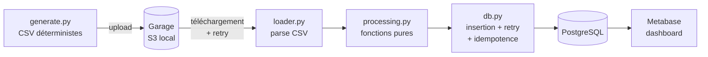

Le chargement des données (I/O : disque, S3) est séparé du traitement, qui ne fait que des calculs purs
(pas d'I/O, pas d'horloge, pas d'aléatoire) et se teste donc sans aucune infrastructure.

```
src/pipeline/
  generate.py     génère les CSV (données fixes) et les dépose dans S3 (--s3)
  s3.py           client S3, listing, téléchargement, retry
  sources.py      d'où viennent les fichiers : S3 ou dossier local
  loader.py       lecture/parsing d'un CSV, checksum SHA-256        (I/O)
  processing.py   sommes par IBAN / banque, flag > 5000             (pur)
  db.py           insertion transactionnelle, idempotence, retry
  schema.sql      schéma relationnel
  run.py          orchestration : source -> traitement -> insertion
  faults.py       injection de pannes pour démontrer les retries
scripts/
  init_garage.sh      initialise Garage (layout, bucket, clé d'accès), sur Compose ou Kubernetes
  setup_metabase.py   crée la connexion, les questions et le dashboard
  deploy_k8s.sh       déploie Postgres, Garage et le CronJob sur Kubernetes
  verify_k8s.sh       vérifie le déploiement de bout en bout
Dockerfile         image de la pipeline
k8s/               manifests Kubernetes (kustomize) ; demo/ contient le job de dépôt des CSV
tests/unit/        tests sans infrastructure
tests/integration/ tests avec PostgreSQL et Garage réels
docs/captures/     captures d'écran citées plus bas
```

## Technologies

| Besoin | Outil |
|---|---|
| Langage | Python 3.12 (CI), 3.14 (local) |
| Base relationnelle | PostgreSQL 16, accès via psycopg 3 |
| S3 local | **Garage** (Deuxfleurs), client boto3 |
| Retry | tenacity |
| Dashboard | Metabase |
| Conteneurs | Docker, Docker Compose |
| Orchestration (niveau 3) | Kubernetes : kind dans la CI, minikube en local |
| Tests, qualité | pytest, ruff |
| CI | GitHub Actions |

**Pourquoi Garage et pas MinIO ?** Le dépôt communautaire de MinIO est en mode maintenance puis archivé, et
ses images Docker officielles ne sont plus publiées : un `docker pull` peut échouer et les images restantes
ne reçoivent plus de correctifs de sécurité. Garage est libre, léger, et dispose d'une image officielle.

## Lancer le projet

Prérequis : Docker, Python 3.12+.

```bash
python -m venv .venv && source .venv/bin/activate
pip install -r requirements-dev.txt
export PYTHONPATH=src

docker compose up -d postgres garage      # Postgres (port hôte 5433) et S3 Garage
./scripts/init_garage.sh                  # layout, bucket « transactions », clés dans .env

python -m pipeline.generate --s3          # génère les CSV et les dépose dans S3
python -m pipeline.run                    # S3 -> traitement -> PostgreSQL
python -m pipeline.run                    # relance : tout est ignoré (idempotence)
```

Dashboard :

```bash
docker compose --profile dashboard up -d  # Metabase sur http://localhost:3000
python scripts/setup_metabase.py          # connexion, questions, dashboard (rejouable)
```

Le dashboard est ensuite sur http://localhost:3000/dashboard/2
(identifiants de développement : `admin@example.com` / `Pipeline-Passw0rd!`).

Tests :

```bash
pytest -m "not integration"   # unitaires, sans infrastructure
pytest                        # tout, avec Postgres et Garage démarrés
```

Les tests d'intégration utilisent leur propre base `pipeline_test` (créée automatiquement) afin de ne jamais
effacer les données de démonstration que lit le dashboard.

Le fichier `.env` (copié de `.env.example`, complété par `init_garage.sh`) est lu automatiquement ; une
variable d'environnement a priorité sur lui.

## Ce qui a été réalisé

### Niveau 1

| Exigence du sujet | Réalisation |
|---|---|
| 1. CSV de 5 à 10 transactions, données non aléatoires | `generate.py` : 3 fichiers (6, 5 et 5 lignes), mêmes octets à chaque exécution. Colonnes du sujet + `montant`. |
| 2. Somme envoyée par IBAN, par banque, reçue par IBAN, flag > 5000 ; chargement séparé du traitement pur | `loader.py` (I/O) et `processing.py` (pur). Le flag est strictement supérieur à 5000 : 5000.00 n'est pas flaggé, 5000.01 l'est. |
| 3. Base relationnelle + fonction d'insertion | `schema.sql`, `db.insert_file_results` |
| 4. Pipeline génération -> traitement -> base | `run.py` et job `pipeline` de la CI |
| 5. Test d'intégration des valeurs en base | `tests/integration/` |
| 6. Scénario d'échec avec captures | voir [C1 à C4](#échec-de-la-pipeline-niveau-1-6) |
| 7. Bug d'insertion et retry | `db.insert_with_retry`, démonstration [B5](#démonstrations-locales) |
| Ne jamais traiter deux fois le même fichier | table `processed_files`, voir [idempotence](#idempotence) |

### Niveau 2

| Exigence du sujet | Réalisation |
|---|---|
| 1. S3 local à la place du disque | Garage dans `docker-compose.yml` |
| 2. CSV déposés dans le S3 lancé en début de pipeline | `generate --s3` ; le job CI démarre Garage en premier |
| 3. Le traitement lit depuis le S3 | `sources.s3_source` (source par défaut de `run.py`) |
| 4. Retry si la récupération échoue | `s3.call_with_retry`, voir [retry](#retry) |

### Niveau 3 : déploiement continu sur Kubernetes

Amélioration choisie : une pipeline CD qui déploie via Docker la production sur Kubernetes (S3, base de
données, et le script de traitement relancé régulièrement).

| Élément | Réalisation |
|---|---|
| Image | [Dockerfile](Dockerfile) : Python 3.12 slim, utilisateur non-root, configuration par variables d'environnement |
| S3 et base | StatefulSets Garage et PostgreSQL avec volumes persistants : [k8s/garage.yaml](k8s/garage.yaml), [k8s/postgres.yaml](k8s/postgres.yaml) |
| Traitement régulier | [CronJob](k8s/cronjob.yaml) toutes les 5 minutes, jamais deux exécutions en parallèle (`concurrencyPolicy: Forbid`). L'idempotence rend les relances sans risque : un fichier déjà traité est ignoré. |
| Déploiement | [scripts/deploy_k8s.sh](scripts/deploy_k8s.sh), rejouable : applique les manifests, initialise Garage, crée le Secret `s3-credentials` (la clé n'est jamais dans le dépôt) |
| Vérification | [scripts/verify_k8s.sh](scripts/verify_k8s.sh) : dépose les CSV de démo dans S3, déclenche le CronJob, contrôle la base (3 fichiers, 16 transactions, 6 flaggées), relance et vérifie l'absence de doublon |
| CD | job `deploy` de la CI : sur `main`, une fois la pipeline verte, il construit l'image, crée un cluster **kind** éphémère dans le runner GitHub Actions (aucune VM n'est disponible), déploie, vérifie, puis **publie l'image sur ghcr.io uniquement si la vérification a réussi** |

Pour rejouer le déploiement sur un cluster local (minikube ici ; avec kind, remplacer la ligne de chargement
par `kind load docker-image ...`) :

```bash
IMG=ghcr.io/haciyil38/tp-integration-continue/pipeline:latest
docker build -t $IMG .
minikube image load $IMG
./scripts/deploy_k8s.sh
./scripts/verify_k8s.sh
kubectl -n pipeline get cronjob,pods
```

Un piège rencontré pendant la validation : Kubernetes injecte dans chaque pod des variables d'environnement
décrivant les Services du namespace. Le Service `postgres` crée ainsi `POSTGRES_PORT=tcp://10.x.x.x:5432`, qui
écrase la variable du même nom lue par l'application et la fait planter. Les pods sont donc déclarés avec
`enableServiceLinks: false`.

### Dashboard

Metabase est connecté à PostgreSQL et le dashboard « Pipeline transactions » (8 cartes) est créé par
`scripts/setup_metabase.py`, rejouable sans doublon : transactions traitées, transactions flaggées, montant
total, total envoyé par IBAN et par banque, total reçu par IBAN, fichiers traités, tableau des transactions
flaggées.

## Choix de conception

### Modèle de données

| Table | Contenu |
|---|---|
| `processed_files` | un fichier traité : clé, checksum SHA-256 (unique), date |
| `transactions` | chaque transaction, avec son booléen `flagged` |
| `sent_by_iban`, `sent_by_bank`, `received_by_iban` | les sommes, par fichier |

Les montants sont des `NUMERIC(14,2)` côté base et des `Decimal` côté Python : aucun arrondi flottant.
Les agrégats sont calculés **par fichier** ; le dashboard les additionne ensuite par `SUM ... GROUP BY`.
Les IBAN du jeu de données sont fictifs.

### Idempotence

Pour ne jamais traiter deux fois un fichier, même en cas de retry, la ligne de `processed_files` est insérée
dans **la même transaction** que tous les résultats :

```sql
INSERT INTO processed_files (file_key, checksum) VALUES (%s, %s)
ON CONFLICT DO NOTHING RETURNING file_key
```

- Si rien n'est retourné, le fichier existe déjà (même clé **ou même contenu** sous un autre nom) : on ne
  fait rien.
- Si l'insertion échoue en cours de route, la transaction est annulée : aucun marqueur ne reste, aucune
  ligne partielle non plus, et le retry repart de zéro.
- Pas de fenêtre de concurrence : c'est la contrainte d'unicité de la base qui arbitre.

### Retry

Un seul mécanisme (tenacity, backoff exponentiel), appliqué à deux endroits, avec une règle commune :
**on ne rejoue que les erreurs transitoires.**

| Où | Rejoué | Pas rejoué (échec immédiat) |
|---|---|---|
| Insertion en base | `psycopg.OperationalError` (connexion perdue, base indisponible) | erreurs de données (contrainte violée...) : elles échoueraient à chaque fois |
| Téléchargement S3 | erreurs réseau, timeouts, HTTP 5xx | clé inexistante (404), accès refusé (403) |

Les retries internes de boto3 sont désactivés pour que tous les essais soient visibles dans les logs.
Si les essais sont épuisés, l'erreur remonte, la pipeline s'arrête avec un code non nul et la CI échoue.

Pour démontrer et tester ces mécanismes, `faults.py` injecte des pannes :
`SIMULATE_DB_FAILURES=2` et `SIMULATE_S3_FAILURES=2` font échouer les 2 premières tentatives.

## Tests et CI

| Type | Ce qui est vérifié |
|---|---|
| Unitaires (21) | calculs sur des valeurs calculées à la main, frontière du seuil 5000, génération déterministe, parsing, logique de retry |
| Intégration (9) | valeurs exactes en base, relance sans doublon, même contenu sous un autre nom, retry de l'insertion et du téléchargement, annulation complète d'une insertion qui échoue, lecture depuis le vrai S3 |

La CI ([.github/workflows/ci.yml](.github/workflows/ci.yml)) a deux jobs :

1. `lint-and-unit` : `ruff check`, `ruff format --check`, tests unitaires.
2. `pipeline` (si le premier réussit) : démarre PostgreSQL et Garage avec Docker Compose, initialise Garage,
   génère les CSV et les envoie dans S3, exécute la pipeline depuis S3, puis lance les tests d'intégration.

Un bug dans le traitement bloque donc le job 1, et le job 2 (la pipeline) n'est jamais exécuté.

## Scénarios démontrés (captures)

### Démonstrations locales

| | |
|---|---|
| **B1** Génération et contenu d'un CSV | 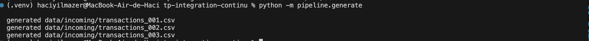 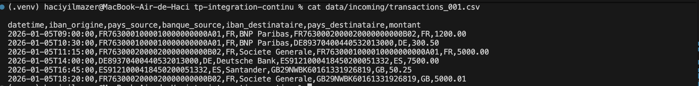 |
| **B2** Pipeline locale : insertion | 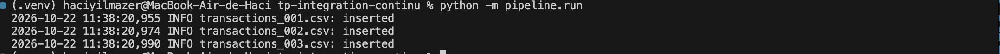 |
| **B3** Résultats en base : sommes par IBAN, transactions flaggées | 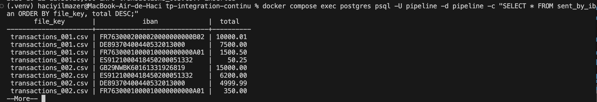 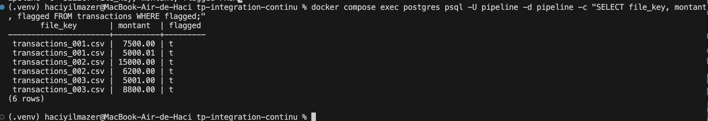 |
| **B4** Relance : fichiers ignorés | 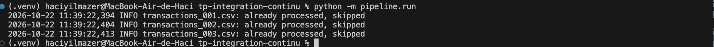 |
| **B5** Retry de l'insertion (2 pannes simulées) | 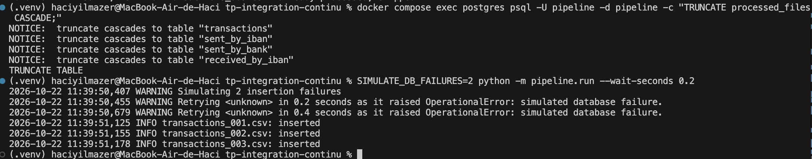 |

### Échec de la pipeline (niveau 1, 6)

Un bug est introduit volontairement dans `flag_transactions` (branche `echec-pipeline`) : `>` devient `>=`,
donc 5000.00 serait flaggé à tort. Les tests le détectent, la CI échoue et la pipeline n'est pas exécutée.

| | |
|---|---|
| **C1** Échec en local | 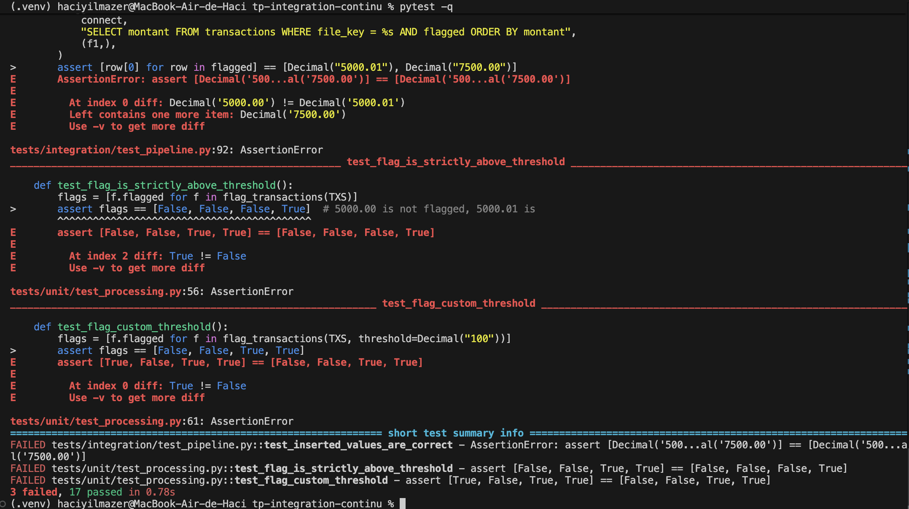 |
| **C2** CI rouge, job `pipeline` ignoré | 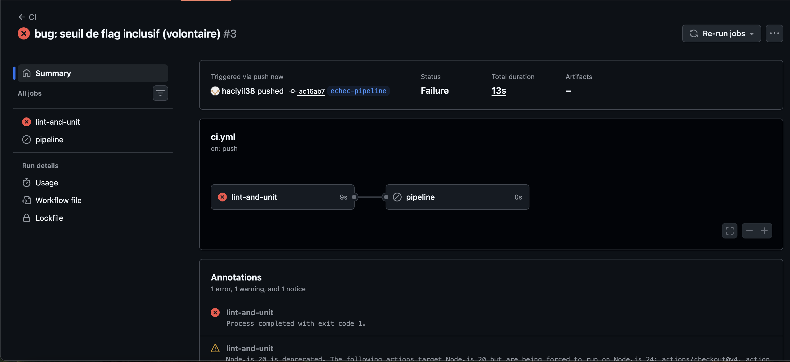 |
| **C3** Log pytest : écart attendu / obtenu | 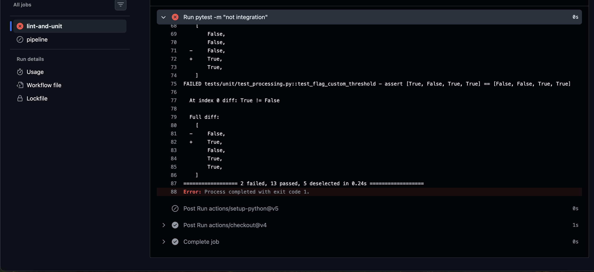 |
| **C4** CI verte après correction | 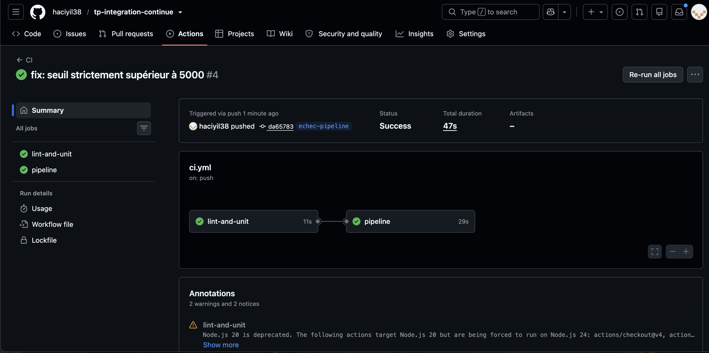 |

### CI et S3 (niveau 2)

| | |
|---|---|
| **A1** CI verte sur `main` | 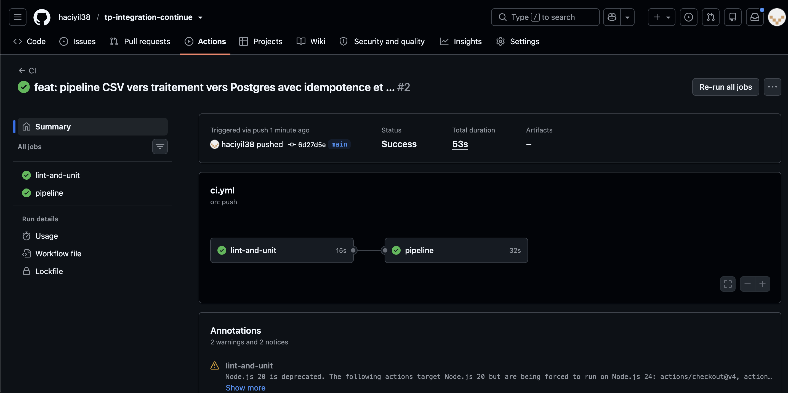 |
| **A2** Étapes du job `pipeline` | 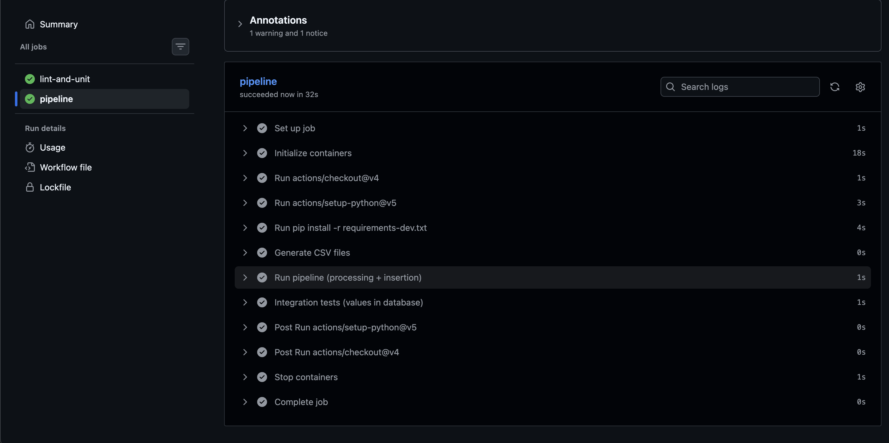 |
| **D1** Génération et envoi dans S3 | 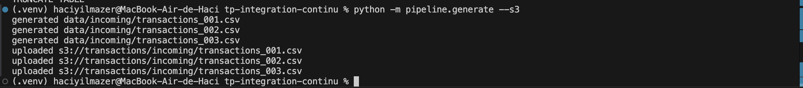 |
| **D2** Pipeline depuis S3 | 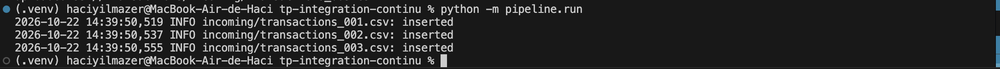 |
| **D3** Relance : fichiers S3 ignorés | 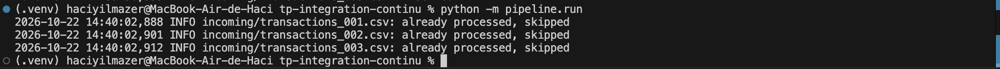 |
| **D4** Retry du téléchargement S3 (2 pannes simulées) | 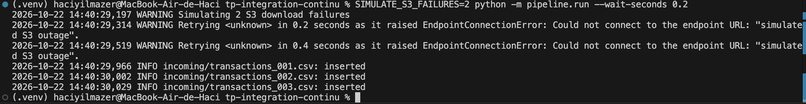 |
| **D5** CI verte avec Garage démarré dans le job | 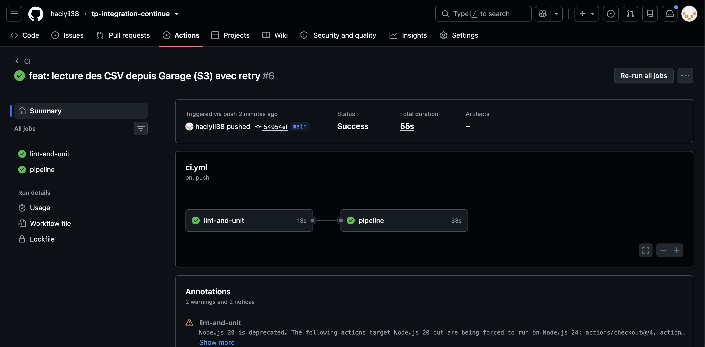 |
| **D6** Contenu du bucket Garage | 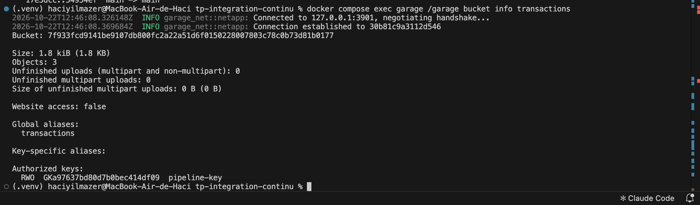 |

### Déploiement continu (niveau 3)

| | |
|---|---|
| **F1** Ressources déployées sur Kubernetes (minikube) : CronJob, pods, volumes | 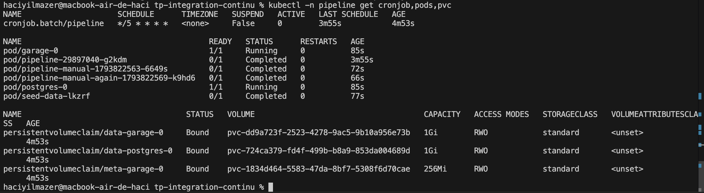 |
| **F2** Vérification du déploiement (`verify_k8s.sh`) : CSV déposés dans S3, CronJob déclenché, contenu de la base contrôlé, relance sans doublon | 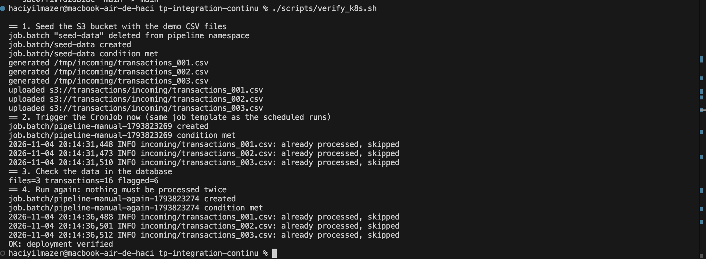 |
| **F3** CI sur `main` : `lint-and-unit` -> `pipeline` -> `deploy`, tous verts | 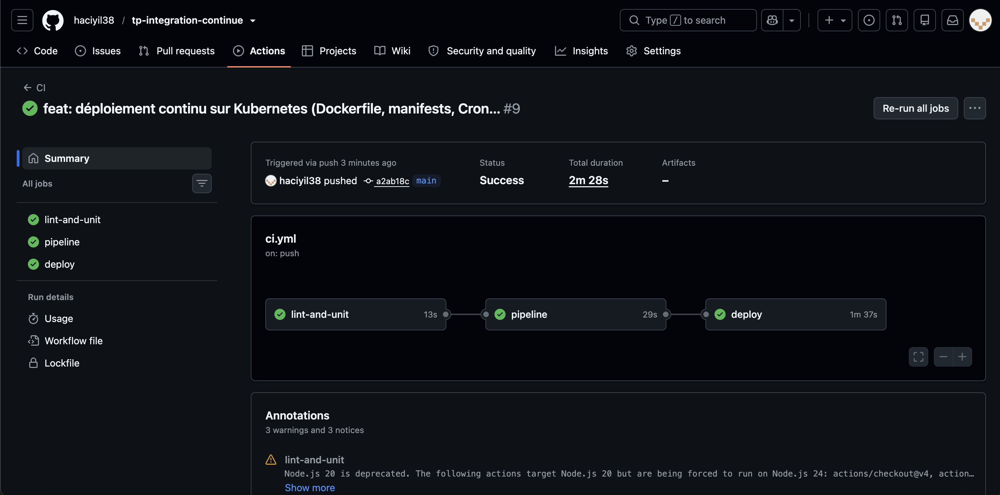 |
| **F3** Étapes du job `deploy` : cluster kind, déploiement, vérification, publication de l'image | 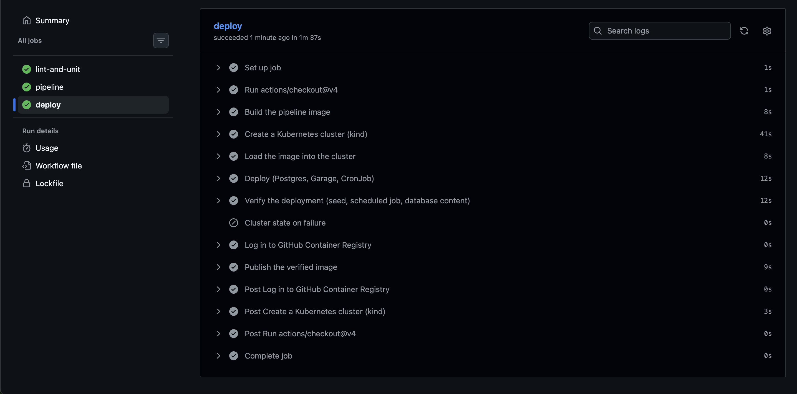 |
| **F4** Image publiée sur ghcr.io, rattachée au dépôt (section « Packages ») | 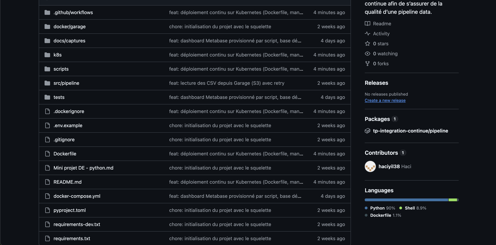 |

### Dashboard

| | |
|---|---|
| **E1** Dashboard Metabase | 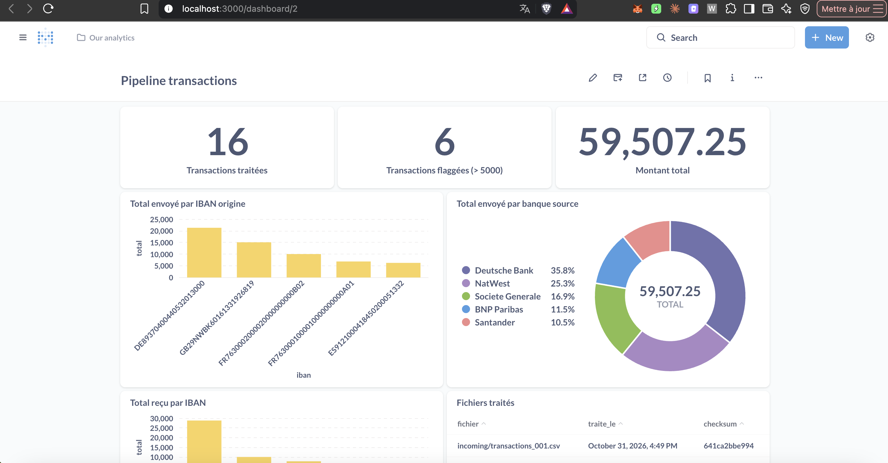 |
| **E2** Connexion à PostgreSQL | 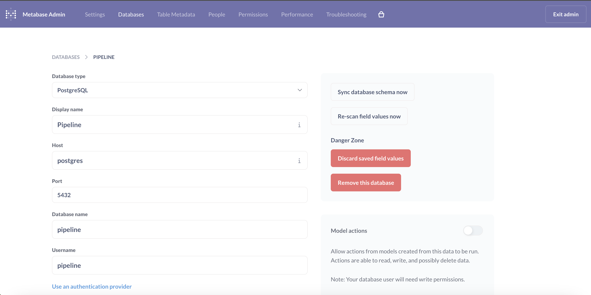 |
| **E3** Une question : requête SQL et résultat | 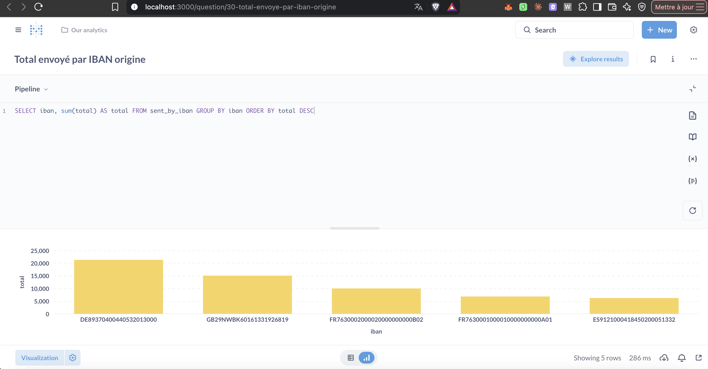 |

## Limites et suite

- **Niveau 3 : une seule amélioration réalisée** (déploiement continu sur Kubernetes). Le déploiement est
  validé sur minikube en local et dans la CI (kind) ; l'OCR, l'extraction par modèle de langage et Terraform/OpenTofu ne sont
  pas faits. Comme aucune VM n'est disponible, le « serveur de production » du CD est un cluster kind
  éphémère créé dans le runner : il prouve que le déploiement fonctionne, mais rien ne reste en service
  après l'exécution.
- Les manifests Kubernetes restent simples : image taguée `latest`, pas de limites de ressources, Secret
  Postgres en clair dans le dépôt (valeurs de développement), un seul exemplaire de chaque composant.
- Les identifiants (Metabase, Postgres, Garage) sont des valeurs de développement, adaptées à un TP local et
  à la CI ; elles ne conviennent pas à une production.
- Metabase utilise sa base H2 embarquée (persistée dans un volume Docker), ce qu'il déconseille en production.
- La pipeline traite tous les CSV d'un préfixe S3 à chaque exécution ; un fichier déjà traité est téléchargé
  puis ignoré (la décision d'idempotence se prend sur son contenu). Pour de gros volumes, on filtrerait
  d'abord sur la clé.
